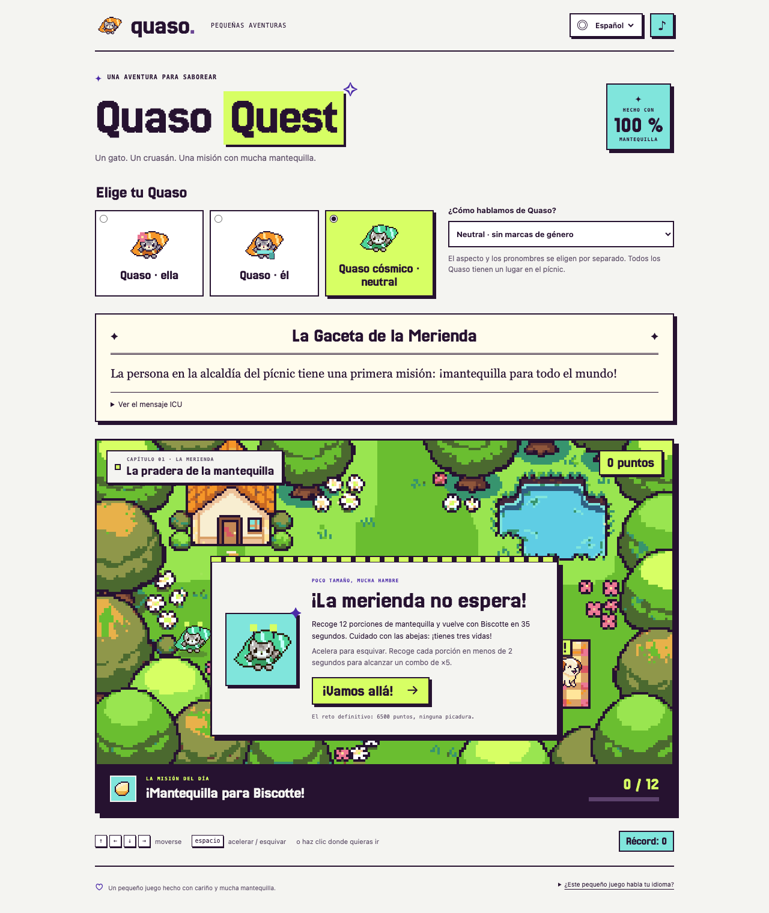

# Quaso Quest

Quaso Quest is a small game for trying the translation workflow. Play as Quaso, a cat shaped like
a croissant: collect twelve pieces of butter, avoid the bees, and return to Biscotte before time
runs out. As mayor of the picnic, your adventures make the local newspaper.

The game opens with its own character-selection screen: choose a female Quaso, a male Quaso, or a
friendly cosmic Quaso. Each suggests pronouns, which you can change independently of appearance. The newspaper, Biscotte's dialogue, and your medal adapt
to that choice using **ICU MessageFormat**. Every Quaso plays by the same rules.

The game starts in **French**. **Spanish is included as a worked translation**; **English and
German are deliberately empty**, so you can try the complete Quaso workflow on a playable game.



## Play

Install [Node.js](https://nodejs.org/) 22.12 or newer, then:

```sh
cd examples/demo-game
npm ci
npm run dev
```

Open the address printed by Vite, normally <http://127.0.0.1:5173>. Inside the game, choose a Quaso
and how the paper should refer to them, then confirm to see the mission and start. Move with the arrows, WASD, or ZQSD; press Space to dash and
Escape to pause. You can also click or tap the meadow to move.

- Bring all twelve butter pats to Biscotte in 35 seconds, with three lives.
- Bees follow predictable patrols. A dash passes through them safely; a hit breaks your combo.
- Collect the next butter pat within two seconds to build a combo, up to ×5 points.
- Finish quickly for a time bonus. A delivery earns bronze; 4,500 points earns silver; 6,500 points
  with no bee hits earns gold. Learn a route and time your dashes to beat your record.

The newspaper reports your progress and the result. Use **Change Quaso** from the pause or result
screen to reopen the in-game character choices. Your current run stays paused while you edit, and
you return to the same screen afterward. Change pronouns or language to compare the same event
without restarting. Expand **Voir le message ICU** below the article to inspect the
message, its arguments, and the catalog used to render it.

Generated sound effects start with the game; the sound button toggles them and remembers your
preference. The interface uses Quaso's own pixel fonts, square controls, and plum, lime, and mint colors.

`npm run build` creates a standalone website in `dist/`; `npm run preview` previews it.

## See what ICU solves

Choose **Español** (or open `?lang=es`) and switch the pronoun setting in the game’s character screen:

| Choice              | Newspaper wording                                                |
| ------------------- | ---------------------------------------------------------------- |
| She/her             | «La alcaldesa del pícnic está lista…»                            |
| He/him              | «El alcalde del pícnic está listo…»                              |
| They/them / neutral | «La persona en la alcaldía del pícnic tiene una primera misión…» |

The neutral version rephrases the sentence. It does not assume masculine wording or require a
literal translation of English singular _they_. The feminine grammatical noun _persona_ refers
to a person of any gender. The cosmic avatar is a playful appearance; neutral wording is
available with every avatar.

`game.json` → `newspaper.ready` is one message, not a sentence assembled from translated pieces:

```text
{gender, select,
  female {La alcaldesa del pícnic está lista para su primera misión: ¡mantequilla para todo el mundo!}
  male {El alcalde del pícnic está listo para su primera misión: ¡mantequilla para todo el mundo!}
  other {La persona en la alcaldía del pícnic tiene una primera misión: ¡mantequilla para todo el mundo!}
}
```

An English translation can keep the same cases while changing the grammar:

```text
{gender, select,
  female {She is ready for her first mission: butter for everyone!}
  male {He is ready for his first mission: butter for everyone!}
  other {They are ready for their first mission: butter for everyone!}
}
```

`newspaper.playing`, `newspaper.won`, and `newspaper.lost` nest a `count` plural inside each gender
case. That lets each translation change titles, pronouns, agreement, word order, and the plural
together. The same `count` drives the counter and the article; the newspaper reports real gameplay.

The config uses `"untranslated": "omit"`: missing translations stay missing, so the runtime can
fall back to French using French plural rules. Copying French fallback text into another language’s
catalog would apply that language’s plural rules instead.

The runtime passes `gender` to every game message. `quaso.config.json` declares its possible
values and their meaning, so translators can introduce a select even where the French has no
visible distinction. The sidecar `game.descriptions.json` gives context for the newspaper and the
character choices. Quaso uploads it as translator guidance, not as player-facing strings.

See [Gender, plurals and other variants](../../docs/variants.md) for the translation rules.

## Translate your first string

You also need Docker with Docker Compose (Docker Desktop includes both). From this directory:

```sh
npm run quaso:setup
```

This starts `docker compose up -d --wait` and creates a **Quaso Quest** project with French as its
source language and ICU enabled. It creates a local administrator and an upload API key, uploads
the two French JSON catalogs and their descriptions, and imports the Spanish example. It prints
the login for <http://127.0.0.1:8000> and saves your local credentials in `.env.quaso`, which git
ignores. Docker uses the official Quaso image, downloading it if it is not available locally.

Re-running setup preserves translations and uploads changes to the French. The Spanish import
preserves existing proofread values, so your edits in Quaso remain yours. For an older i18next
playground, setup first uses Quaso's conversion API to convert stored sources, translations, and
suggestions together, preserving their history and review state. It stops before uploading if
conversion is refused, for example while a translation job is running. Existing translations of
changed story text may need review; download after setup to refresh any old local catalogs. If download reports local edits, review
those files before using `npm run quaso -- download --overwrite-local` to replace them.

1. Sign in to Quaso using the printed email and password.
2. Open **English**, find `game.json` → `welcome.start`, and translate `C'est parti !` to `Let's go!`.
3. Save the translation, then download it:

   ```sh
   npm run quaso -- download
   ```

4. Reload the game, choose **English**, and see your words on the start button. Untranslated text
   still appears in French. You can also open `?lang=en` or `?lang=de` directly.
5. Translate `newspaper.ready`, keeping the `female`, `male`, and `other` cases. Download again and
   try each pronoun choice. Open Spanish in Quaso to compare its complete-sentence alternatives.

No LLM key is needed to translate by hand. To try automatic translation, configure a Gemini key
in Quaso's **Settings → AI translation**, then run `npm run quaso -- translate --language en` and
download again. Automatic translation is off initially so both practice languages start empty.

## The everyday loop

```sh
npm run quaso -- upload                   # Send changed French text and translator context.
npm run quaso -- status                   # See progress for all target languages.
npm run quaso -- download                 # Bring translations into src/locales/.
npm run quaso -- status --fail-on untranslated  # Try the release completeness check.
```

Keep `{count}`, `{score}`, and other argument names intact when translating. Translate whole
cases, preserving the ICU syntax; use the plural categories your language needs. `other` is the
fallback for every select. The butter and lives counters demonstrate exact `=0`, `one`, and
`other` plural cases (plus the `many` category French and Spanish use for millions); the meows are an array. Try a long start-button translation to exercise the
24-character limit. The game is small enough to check every source string.

`npm run quaso -- COMMAND` runs the installed `@quaso-i18n/cli` with `.env.quaso` loaded. Replace
`COMMAND` with a CLI command such as `status`. To run `npx @quaso-i18n/cli` directly, export
`QUASO_HOSTNAME` and `QUASO_API_KEY` from that file into your shell. For a different instance,
use its URL and an upload-scoped API key; choose French as the source language and turn on
**Settings → Placeholders → ICU MessageFormat** before its first upload. For an existing i18next
project, follow [Move to ICU](../../docs/move-to-icu.md) instead of simply changing that setting.
The setup script always manages the local playground.

## Find your way around the code

| File                                    | What to look for                                                         |
| --------------------------------------- | ------------------------------------------------------------------------ |
| `src/i18n.js`                           | Load bundled catalogs, fall back to French, change language.             |
| `src/locales/fr/common.json`            | Menus, controls, and the surrounding page.                               |
| `src/locales/fr/game.json`              | ICU dialogue, newspaper stories, plurals, and interpolation.             |
| `src/locales/fr/game.descriptions.json` | Context uploaded to Quaso for translators and the LLM.                   |
| `src/locales/es/`                       | Complete Spanish example with neutral sentence rewrites.                 |
| `src/locales/en/`, `src/locales/de/`    | Empty catalogs, filled by `quaso download`.                              |
| `quaso.config.json`                     | Source files, target languages, declared arguments, and a length limit.  |
| `src/game.js`                           | Movement, patrols, dash, combos, clock, and medals.                      |
| `src/main.js`                           | Drawing and interaction, with translation calls where text is displayed. |
| `src/style.css`                         | Layout, responsive styles, and animations.                               |
| `scripts/setup.mjs`                     | Local Docker setup, ICU migration, source upload, and Spanish import.    |

Quaso is a development tool: the running game reads ordinary JSON catalogs and formats their ICU
messages locally. It never needs to connect to Quaso. Downloaded files are included in the next
Vite build. `npm test` checks the game rules and translation behavior, including source fallback,
gender selection, and nested plurals.

## Manage the playground

```sh
docker compose up -d       # Start again; translations are kept in the named volume.
docker compose logs --tail 100 quaso
docker compose down       # Stop; keep your translations.
```

Port 8000 must be free. This Compose project is named `quaso-quest` and listens only on your
computer's loopback interface. Its setup key is intentionally public for local testing; use the
[deployment guide](../../docs/deploy-docker.md) for a real public instance. To test changes to Quaso
itself from this checkout, run `docker compose up -d --build --wait`.

For a completely fresh playground, `docker compose down -v` **deletes its server data**, including
accounts and translations. Then run `npm run quaso:setup` again. Downloaded translation files stay
in `src/locales/en/` and `src/locales/de/`; restore their contents to `{}` if you also want the
practice languages to start untranslated again. Keep the Spanish example to compare and import.

The sample workflows in `.github/workflows/` show source upload and translation download in CI.
Copy them to your game's repository and configure `QUASO_HOSTNAME` and `QUASO_API_KEY`. See
[Add Quaso to your game](../../docs/add-to-your-game.md) for details and repositories that contain
several packages.

## Check the complete workflow

From a Quaso repository checkout, with Node.js 26 and dependencies installed at the root and in
`examples/demo-game`, run `node scripts/demo_game_workflow.ts` from the root. It creates a temporary
server and project, exercises the actual setup script and installed CLI, checks a fresh and repeated
setup, preserves an older playground’s reviewed translations through ICU conversion, and verifies
that target-added gender selects round-trip while an incomplete select is refused. It stubs only
the Docker invocation; no existing playground or translation server is changed.
